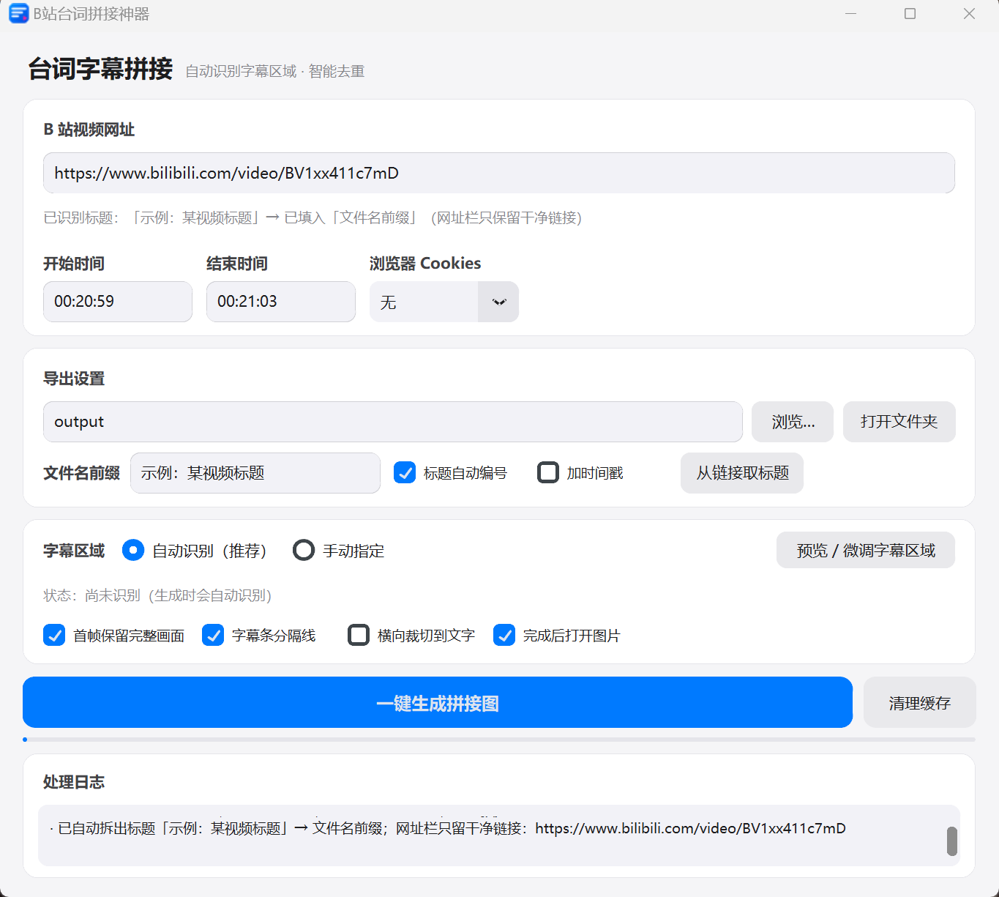

# 字幕长图 · bili-subshot

把 B 站视频里烧在画面上的字幕（硬字幕）按句裁切、纵向拼成一张长图。
给它一个链接和一段起止时间，剩下的事情程序自己做完。

同类工具大多要你先手动截图再拼，这个是从视频直接出图。


[](https://github.com/Heisenberg-cmd0079/bili-subshot/actions/workflows/tests.yml)



---

## 它能做什么

**字幕位置不用你填。** 程序先采样一批帧，按「白字 + 黑描边 + 字号像文字」三个条件找字形，行存在率高的连续几行就是字幕带。找歪了，可以在预览窗口里拖滑块手动框。

**重复帧会被去掉。** 同一句台词在片子里往往停留几十帧，输出只留一帧。判据是字幕字形的重叠度，不是整幅画面的相似度——画面在动也不影响判断。

**粘贴就能用。** B 站客户端复制的整段「【标题】链接」直接粘进网址栏：标题自动填进文件名前缀，`vd_source` 这类分享参数自动清掉。

**文件名不用操心。** 默认按「标题_01.png」「标题_02.png」往后排，不会覆盖旧图。

**下载过的不会白下。** 同一视频 + 同一时间段，缓存还在就直接用（生成成功后默认清理临时文件，命令行加 `--keep-cache` 可以留着）。

另外：需要 1080P 时可以从 Edge / Chrome / Firefox 借登录态；界面在高 DPI（175% 缩放）下也能完整显示；附带命令行版，方便批处理。

首帧完整画面、字幕条分隔线、横向裁切到文字、完成后自动打开图片——这几个都有开关。

## 快速开始

```bash
git clone https://github.com/Heisenberg-cmd0079/bili-subshot.git
cd bili-subshot
pip install -r requirements.txt
```

还需要 **ffmpeg**（yt-dlp 用它切片）：

| 平台 | 安装 |
| --- | --- |
| Windows | `winget install ffmpeg` |
| macOS | `brew install ffmpeg` |
| Ubuntu / Debian | `sudo apt install ffmpeg` |

启动图形界面：

```bash
python gui_app.pyw        # Windows 上也可以用 pythonw，避免弹出控制台
```

## 图形界面用法

1. 在「B 站视频网址」里**直接粘贴客户端复制的整段内容**（【标题】+ 链接）——
   标题会自动填进「文件名前缀」，链接会自动去掉 `vd_source` 等分享参数；
   网址栏随后只显示干净链接，识别到的完整标题会在下方那行小字里回显
2. 填开始 / 结束时间（`00:20:59` 这种格式）
3. 「导出设置」里选导出文件夹，保持「标题自动编号」勾选，输出即 `标题_01.png`
4. 「字幕区域」保持默认的 **自动识别（推荐）**；想先确认效果就点 **预览 / 微调字幕区域**
5. 点 **一键生成拼接图**，完成后自动打开图片

## 命令行用法

```bash
python -X utf8 bilibili_subtitle_stitcher.py \
    --url "【某视频标题】https://www.bilibili.com/video/BV1qnuq6dEga?vd_source=xxx" \
    --start 00:21:41 --end 00:22:35 \
    --out "output" --name 台词拼接
```

| 参数 | 说明 |
| --- | --- |
| `--url` | 视频链接；也可直接粘贴「【标题】https://…」整段内容 |
| `--start` / `--end` | 起止时间，如 `00:21:41` |
| `--out` | 导出文件夹 |
| `--name` | 输出文件名前缀（不带编号与扩展名） |
| `--title` | 强制指定文件名前缀（优先级最高） |
| `--no-number` / `--number` | 关闭 / 开启自动编号 |
| `--cookies {无,Edge,Chrome,Firefox}` | 用浏览器 cookies 拉取更高码率 |
| `--region 80,92` | 手动指定字幕区域（占画面高度百分比），不填即自动识别 |
| `--no-cover` | 首帧不做完整画面 |
| `--no-separator` | 字幕条之间不加分隔线 |
| `--crop-horizontal` | 横向裁切到字幕文字范围（更紧凑） |
| `--keep-cache` | 结束后保留下载的临时视频 |

不带参数运行时读 `config.json`（与图形界面共用同一份配置；文件在第一次保存或退出时才生成）。
临时视频缓存在 `%TEMP%\zimupinjie\<视频+时间段哈希>\clip.mp4`（macOS / Linux 下是系统临时目录）。

## 工作原理

难的不是拼接，是判断**哪一行是字幕**、以及**哪两帧说的是同一句**。

### 1. 取片段

`yt-dlp` 下载视频流、`ffmpeg` 按 `--start/--end` 切片，结果按「视频 + 时间段」哈希缓存，缓存还在时重复跑不会重新下载。

### 2. 抽帧

按固定间隔对片段采样若干帧（默认只取画面下部区域，减少计算量）。

### 3. 找字幕在哪

早先的做法是「第一帧里所有亮像素所在的行都算文字」，碰上游戏 UI 或漫画白底就整段跑偏。现在改成按几个判据打分行：

| 判据 | 说明 |
| --- | --- |
| 白字 | 亮度高、饱和度低 |
| **黑描边** | 硬字幕的白字外面都描了一圈黑边；画面里的白底、亮色块不满足 |
| **尺寸像字** | 字形连通块的高宽 / 面积 / 填充率要落在「文字」范围内，整片白底与色块被挡掉 |
| 行存在率 | 该行在采样帧里出现字形的帧占比（常驻字幕行接近 100%） |
| 行内容变化程度 | 字幕会换句、行内像素量随之起伏；常驻的白色工具栏、播放器控件纹丝不动 → 降权 |
| 位置先验 | 越靠画面底部的候选段权重略高 |

先用这几维挑出**种子行段**，再逐帧从种子向上下**生长**，最后取所有帧范围的分位数（3% / 97%）而非严格并集——所以「同一句分两行显示」时上面那行一般在范围内，极端情况仍可能漏。
最后按字高自动加留白（文字带高 × 25%），并用所有保留帧的真实文字边缘做兜底扩展。

> 一个实测过的坑：录屏类视频底部常有一条常驻的白色工具栏，行存在率能到 100%，比字幕「更像文字」。
> 这类行几乎不换内容，靠「行内容变化程度」这一维就被压下去了（实测字幕行变化率约 0.6，工具栏约 0）。

### 4. 判断哪两帧是同一句

只比较**字幕字形掩码**（白字 ∩ 黑描边附近 ∩ 尺寸像字），而不是整幅画面：

- 同一句字幕：掩码 IoU 实测 0.73 - 0.79，包含度 0.85 - 0.91
- 不同台词：掩码 IoU 实测 ≤ 0.10，包含度 ≤ 0.20

阈值取 IoU 0.50、包含度 0.82，两边都留足余量；分组时与该组**最近 3 帧**比较（容忍逐字出现与轻微抖动），
**字幕短暂消失不超过 1 秒也不断组**，事后再做一次「相邻组间隙 ≤ 2.5 秒且字形相同则合并」的兜底。
每组再挑「字形像素最多」的那一帧，规避淡入淡出 / 半透明帧。

### 5. 裁切与拼接

裁切窗口强制夹在分析区内（杜绝 numpy 负索引把字幕切到画面最底部这类事故），按字形边缘兜底扩展，
再逐条纵向拼接，可选画分隔线、首帧补一张完整画面。

## 实测效果

这些是开发过程中跑过的片段，都是真实输出：

| 视频 | 特点 | 结果 |
| --- | --- | --- |
| `BV1nKTC6CEBq` 00:20:57 - 00:21:53 | 1080p 漫画画面（白底黑线满屏）+ 多句两行字幕 | 224 帧 → 17 句，两行字幕完整、零重复（修复前 39 句，含 6 处重复与多处截断） |
| `BV1nKTC6CEBq` 00:05:10 - 00:05:50 | 同片彩色段落（含两行字幕「你来炒 / 好的」） | 160 帧 → 11 句，全部正确 |
| `BV1RCYX6bEH5` 00:09:27 - 00:09:57 | 1080p 游戏录屏，字幕在底部 | 120 帧 → 17 句，全部正确 |
| `BV1gBeN6HEMs` 00:01:48 - 00:02:03 | 1080×1080 录屏，画面底部有常驻白色工具栏 | 60 帧 → 11 句，工具栏被正确排除 |
| `BV1qnuq6dEga` 00:21:41 - 00:22:35 | 画面中部有大块静态书本文字 | 216 帧 → 24 句，全部正确 |

## 回归测试

```bash
python -X utf8 tests_naming.py
```

**93 条检查**（原有 45 条 + 后来补的 48 条），覆盖链接解析（含嵌套括号标题）、自动编号命名、
封面裁切契约、字幕掩码的两种模式、描边策略传递、GUI 失败/跳过契约，以及 GUI 交互本身。
本地约 3 秒跑完（会短暂弹出一个窗口再自动关闭）。

GitHub Actions 上也在跑同一套（Ubuntu + xvfb），所以那枚 green 徽章是真跑出来的，不是摆设。

更详细的界面说明、历史修复记录与参数说明见 **[docs/使用说明.md](docs/使用说明.md)**。

## 常见问题

**Q：只能下到 360P / 480P？**
在「浏览器 Cookies」里选你登录过 B 站的浏览器（Edge / Chrome / Firefox），就能拿到 1080P。

**Q：字幕识别不准 / 少了几句？**
先点「预览 / 微调字幕区域」，红色半透明带就是实际保留范围，拖两个滑块手动框准；
如果换了片源仍然不行，把视频的时间范围和画面特征（白底？彩色？字幕在中间？）发到 Issues。

**Q：报 ffmpeg 相关错误？**
见上面「快速开始」里的 ffmpeg 安装表，装完重开程序。

**Q：缓存占空间？**
临时视频在系统临时目录的 `zimupinjie` 下，界面点「清理缓存」，或直接删掉那个目录。

**Q：Windows 控制台中文乱码？**
统一加 `-X utf8` 参数，例如 `python -X utf8 bilibili_subtitle_stitcher.py …`。

## 已知限制

- 依赖 B 站页面与接口，**B 站改版可能导致失效**（欢迎提 Issue）
- 只处理**硬字幕**（烧录在画面里的字幕），不提取 CC 字幕
- 竖屏视频、超宽画面、动态字幕（综艺花字）尚未充分测试
- **目前只在 Windows 11 + Python 3.14.7 上实测过**；macOS / Linux 下字体与 yt-dlp 路径可能有小问题
- 长视频（十几分钟）识别会占用较多内存与时间，建议按几百秒的片段跑
- 长时间段的识别阈值是按 1080p 样本调出来的，4K / 低码率 / 彩色字幕的识别率可能下降

## Roadmap

- [ ] **浏览器插件版**：在网页播放器上按时间段抓帧直接拼接，不用先下载视频。
      已确认可行：B 站播放器的 `<video>` 能用 `canvas.drawImage` 抓帧、画布不会被污染；
      一次实验里 8 帧 seek + 抓取共 110 ms（缓冲区内约 14 ms/帧）。冷 seek 和长时间任务还没测。
- [ ] 直接读本地视频文件（先录屏再处理，不联网）
- [ ] 有官方字幕轨时优先读文本和时间轴（比像素识别准得多；字幕轨本身也可能有错漏）

## 免责声明

- 本项目是**非官方工具**，与哔哩哔哩（Bilibili）没有任何关联，未获得其授权、认可或背书。
- 本工具仅供**个人学习、研究与备份自己有权访问的内容**使用。
- 使用者应自行遵守哔哩哔哩用户协议、《中华人民共和国著作权法》等适用法律法规，
  **不得用于批量抓取、二次分发、商业用途或任何侵犯他人权利的场景**。
- 本仓库不包含任何视频内容、Cookie、账号凭证或密钥；下载的视频仅存放于使用者本机的临时目录。
- 因使用本工具产生的一切后果由使用者自行承担，作者不承担任何责任。

## 许可协议与致谢

**本项目的源码是公开的，但它不是 OSI 定义下的「开源项目」**——所用协议**禁止商业使用**。
（OSI 的开源定义要求不得歧视任何使用领域，包括商业用途，所以「禁止商用」与「开源」在定义上互斥。
这里如实说明，免得你按「开源」的预期来用它。）

`Required Notice: Copyright 2026 Heisenberg-cmd0079`

代码采用 [PolyForm Noncommercial License 1.0.0](LICENSE)
（[官方说明](https://polyformproject.org/licenses/noncommercial/1.0.0)、含专利授权条款）。

| 可以 | 不可以 |
| --- | --- |
| 个人学习、研究、试用、私人娱乐、业余爱好 | **任何商业用途**（把它或其修改版用于收费产品、收费服务、商业项目） |
| 自己修改、自己用 | 把修改版拿去卖、拿去变现 |
| 慈善机构、教育机构、公共科研、公共安全/卫生、环保、政府机构使用 | 再授权（sublicense）或转让许可给别人 |
| 分发副本（需一并附带本协议与上面那行 Required Notice） | 声称这是哔哩哔哩官方项目、或暗示获得其背书 |

**需要商业授权**请通过 Issues 联系作者——作者是版权人，可以另行授权（也可以自己商用）。

### 关于内容权利（与上面的代码许可无关）

上面的许可**只针对代码**，不授予任何第三方视频、字幕、音乐、人物图像或商标的使用权。
请仅处理你自行创作或已取得相应授权的内容——**能观看不等于取得授权**。

感谢这些开源项目：[yt-dlp](https://github.com/yt-dlp/yt-dlp)、[OpenCV](https://opencv.org/)、
[customtkinter](https://github.com/TomSchimansky/CustomTkinter)、[Pillow](https://python-pillow.org/)、[NumPy](https://numpy.org/)。
